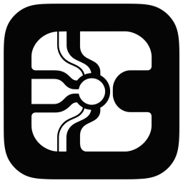

<p align="center">
  <picture>
    <source media="(prefers-color-scheme: dark)" srcset="design/logo/chernobyl-tile-256.png">
    
  </picture>
</p>

# CHERNOBYL

One interface. Every agent. A mobile-first control app for AI agents: monitor hosts and
agents, watch live session output, and approve or reject permission requests from your
phone — with the companion backend enforcing every decision.

**[Project page](https://ndcompany.in/open-source/chernobyl)** · **[User guide](https://github.com/NDcompany/Chernobyl/wiki)** · **[Download](https://github.com/NDcompany/Chernobyl/releases/latest)**

Monorepo layout:

```
packages/protocol   Shared TypeScript protocol: types, message envelopes,
                    runtime validators, seed data and the MockEngine.
services/companion-rs
                    The real backend (Rust, std-only, one binary): protocol-v2
                    WebSocket server + pairing/QR + E2E session layer +
                    OpenCode, Claude Code, Codex and Antigravity live runtimes + loopback
                    diagnostics. This is the production runtime the phone
                    talks to.
services/host       TypeScript reference host (Node + ws): MockEngine + the
                    protocol conformance/differential suite the Rust engine was
                    ported test-for-test from. Still built and tested by `verify`;
                    not the production enforcement point.
apps/mobile         Expo (React Native) app — Expo Router, TanStack Query,
                    Zustand, React Hook Form + Zod, SQLite, SecureStore.
```

## Install

Download the signed APK from the [latest release](https://github.com/NDcompany/Chernobyl/releases/latest)
(Android 7.0 or later; a separate APK covers Android 4.4 tablets) together with the Windows companion
and `SHA256SUMS.txt`. The app IDs are `in.ndcompany.chernobyl` and `in.ndcompany.chernobyl.kitkat`.
To get updates automatically, add `https://github.com/NDcompany/Chernobyl` to
[Obtainium](https://github.com/ImranR98/Obtainium). CHERNOBYL is not on Google Play.
Setting up the companion: [`docs/INSTALL.md`](docs/INSTALL.md).

## Quick start

```powershell
npm install          # workspaces
npm run verify       # TS: typecheck + lint + tests + builds + android export
npm run verify:rust  # Rust runtime: tests + clippy + fmt + self-test
```

Building + verifying a release binary, install/autostart, backup/restore, and
SmartScreen troubleshooting: see [`docs/INSTALL.md`](docs/INSTALL.md) (ADR-007 —
unsigned binary + published SHA-256 checksums). Remote access setup (LAN,
Tailscale, tunnels), failover, and hardening: see [`docs/REMOTE-ACCESS.md`](docs/REMOTE-ACCESS.md).

Run the pieces:

```powershell
# real backend (Rust companion) — the runtime the phone talks to
cargo run --release --manifest-path services/companion-rs/Cargo.toml
#   default ws://127.0.0.1:8787 (+ loopback diagnostics on 9487)
#   add --token <t> (or HOST_TOKEN=...) to require auth; --pair to print a pairing QR
#   add --tui to boot with the terminal UI (status / sessions / approvals keybinds)

npm run dev:mobile   # Expo dev server (press a / w for Android / web)
npm run dev:host     # OPTIONAL: Node reference host (MockEngine) for differential testing
```

The app runs against the **offline mock by default** (no backend needed). Set
`EXPO_PUBLIC_HOST_WS_URL` (e.g. `ws://10.0.4.21:8787`) in `apps/mobile/.env.local`
to connect the real companion instead. If the companion was started with a token
(`HOST_TOKEN`), save the same token via the in-app "Connect host" modal — the app
holds it in the device keystore. Beyond loopback a token alone is not enough to run
commands (decision D2): the E2E session handshake must complete first (see
`services/companion-rs/README.md`, "E2E wire format").

**Android 4.4 tablet?** The main app needs Android 7.0. `android-kitkat/` is a separate native
client for KitKat (API 19) with the same pairing and E2E encryption: sessions, live conversations,
approvals, alerts, files and git (ADR-019; install steps in `docs/INSTALL.md`).

## Screens

| Screen | Route | Notes |
| --- | --- | --- |
| Onboarding | `/onboarding` | 3 slides, contour graphics, skip |
| Sign in | `/sign-in` | mock auth, no credentials checked |
| Home dashboard | `/` (tabs) | stats, active agents, pending approvals, activity, search |
| Agents | `/agents` | search + full list |
| Agent details | `/agent/[id]` | capabilities, workspaces (Files, Changes), sessions, activity, start session |
| Files | `/files/[workspace]`, `/file/[workspace]` | read-only folder browser and text viewer of an allow-listed workspace |
| Changes | `/changes/[workspace]` | git status, diffs, stage/unstage, commit, pull (fast-forward only) and push (both confirmed) |
| Terminal | `/terminal/[workspace]` | opt-in (ADR-020): one command line at a time in a workspace, streamed output, exit code, Stop; only when the PC sets `terminal.enabled` |
| Sessions | `/sessions` | All / Running / Waiting / Completed filters + search |
| Session workspace | `/session/[id]` | live conversation for transcript sessions (see below); otherwise Output / Files / Activity, send, interrupt |
| Approvals | `/approvals` | pending (live countdowns) + decided history |
| Permission request | `/permission/[id]` | exact command, risk, Approve once / Reject, separate "approve for session" |
| Profile | `/profile` | settings entries, sign out (confirmed) |
| Settings | `/settings/[section]` | hosts, integrations, notifications, appearance, security, audit |
| New task | `/new-task` (modal) | pick agent (and a workspace for live agents), describe the job |
| Connect host | `/connect-host` (modal) | token → SecureStore keystore |

## How state works

- **Server state** (hosts, agents, sessions, permissions, activity) lives in one TanStack
  Query snapshot. Transport events merge through `applyServerMessage`; the offline mock
  and the real WebSocket transport emit the identical `ServerMessage` stream.
- **Client state** (auth, onboarding, settings, search/filter, toasts) is Zustand,
  persisted to SQLite (`src/platform/storage.ts`).
- **Commands** (`src/data/commands.ts`) attach fresh `commandId`s, suppress identical
  concurrent sends, and the WS transport replays unresolved commands with the *same*
  `commandId` on reconnect — the host answers duplicates with `duplicate: true` acks
  instead of executing twice.
- **Permission requests** expire after 2 minutes (protocol `PERMISSION_TTL_MS`) for the mock
  and demo, and after 24 hours for live runtime requests (none of the runtimes expires its own);
  stale requests are never decidable, on either side.
- **Live transcripts** arrive on the same transport stream and fold into a second, memory-only
  store (`src/data/live.ts`) while a conversation screen is open.

## Live agent sessions

ADR-015. On a transcript session the phone shows a live conversation: streaming text and
thinking, tool cards with input, output and diffs, approvals inside the tool card (with the
runtime's own options, such as allow once, allow for the session, a persistent rule after a
confirm that names the rule and file, or deny with a reason), follow-up prompts, a Stop
button, and MCP server status with sign-in and reconnect. Transcripts are held in memory only,
on both sides, and are never journaled (`docs/PRIVACY.md`).

| Runtime | How | Status |
| --- | --- | --- |
| Claude Code | **driven**: the companion starts `claude.exe` (stream-json on stdio) in an allow-listed folder, with permission mode, end session, MCP status and past-session history; **hook ingress** for terminal and VS Code sessions ("Live on PC", fork, and phone approvals after `--install-hooks`) | live round trip passed against Haiku, CLI 2.1.310 (about $0.01 per run); hook round trip verified with `claude -p` 2.1.322 |
| OpenCode | **attach** to a running `opencode serve` (HTTP + SSE), never a second server; since ADR-021 also the model picker, photos, slash commands, context, rename and fork, and the serve's folder as its workspace (Files, Changes, Terminal) | live tests passed on 1.19.4 with local Ollama (`qwen3.5:4b`, 24k context) |
| Codex | **driven**: one `codex app-server` per adapter, each session a thread; its threads in the workspaces (the Codex app's too) listed, replayed, resumed and forked; model picker, images, context, rename | live runs passed 2026-11-12 on codex-cli 0.167.0-alpha.4.1 (ChatGPT plan, 11 short turns) |
| Antigravity | **driven**: one `agy acp` (Agent Client Protocol) per adapter, each session an agy session (ADR-022) | inline approvals (allow once or deny), steering follow-ups, interrupt, model, images, slash commands, permission mode, history from agy's own list; no MCP status; live run against agy 1.5.6 |

To enable them, add to `companion.json` (keys documented in `services/companion-rs/README.md`):

- Claude Code: `"workspaces": ["C:\\path\\to\\project"]` on the existing `claude` entry
  (optional `binary`, `maxSessions` 1-16, default 3, and `permissionMode`: `default`,
  `acceptEdits` or `plan`). Without `workspaces` the entry stays a hook ingress only.
- Codex: a new entry `{ "id": "codex-1", "type": "codex", "enabled": true, "workspaces": [...] }`
  or `setup-windows.ps1 -Codex`. `codex.exe` is found on PATH or in the Codex app's install at
  every start (`binary` overrides it; the npm `.cmd` shim is refused).
- Antigravity: `{ "id": "agy-1", "type": "antigravity", "enabled": true, "workspaces": [...] }`
  (optional `binary`, default `%LOCALAPPDATA%\agy\bin\agy.exe` then `agy.exe` on PATH; `model`
  for new sessions, such as `gemini-3.8-flash-low`; `maxSessions` 1-16, default 3), or
  `setup-windows.ps1 -Antigravity`. Sign in to agy once in a terminal first. The phone answers
  agy's own permission prompts once at a time; the companion never writes agy's settings.

**Allow-listing a folder means trusting it.** The phone can start an agent in it, and Claude
runs in print mode, which skips its folder-trust dialog, so that folder's project hooks and MCP
servers load when the session starts. Drive roots, your user-profile root and any folder that
contains the CHERNOBYL data directory are refused. Bypass-permissions modes are never reachable
from the phone. Per-runtime limits: `docs/INTEGRATIONS.md`; threats and controls:
`docs/decisions/PHASE5-THREAT-MODEL.md` §3.12.

**Claude Code sessions running on the PC (ADR-018).** A session you started in a terminal or
VS Code (in an allow-listed folder) shows "Live on PC" on the phone and streams as it runs.
Sending from the phone forks it into a new session (`claude --resume <id> --fork-session`); the
PC session is not touched. To approve its permission prompts from the phone too, install the
hook once (it edits `%USERPROFILE%\.claude\settings.json` after a backup to
`settings.json.chernobyl-backup`):

```powershell
& "$env:LOCALAPPDATA\Programs\CHERNOBYL\chernobyl-companion.exe" --install-hooks   # or setup-windows.ps1 -PhoneApprovals
& "$env:LOCALAPPDATA\Programs\CHERNOBYL\chernobyl-companion.exe" --uninstall-hooks # undo
```

The phone then gets Allow / Deny for those prompts while it is connected; if it does not answer
in 120 s (`--install-hooks --timeout <s>` changes that), or no phone is connected, the PC asks as
usual.

**Files and Changes (ADR-016).** From an agent's workspace (agent screen, or the Files and
Changes chips on a live conversation) the phone browses the allow-listed folder read-only
(secrets masked, `.env*` values hidden) and reviews git: status, diffs, stage and unstage,
commit, pull (fast-forward only from the upstream; never a merge commit or rebase) and push
the current branch to its upstream (never forced). No file editing.

**Terminal (ADR-020, opt-in, off by default).** With `"terminal": {"enabled": true}` in
`companion.json` (`scripts\setup-windows.ps1 -EnableTerminal`) the paired phone gets a Terminal
per workspace: one command line through the PC's shell (`cmd.exe` on Windows), cwd = the
workspace, **without the agents' approval prompts**. 120 s at most (Stop kills the process tree),
output ANSI-stripped, redacted and capped at 1 MiB, every run journaled and audited. Setup
options (`-OpenCode`, `-StartOpenCode`, `-EnableTerminal`, `-ConfigOnly`): `docs/INSTALL.md`.

## Backend runtime

### `services/companion-rs` — the real runtime (Rust, std-only)

One zero-dependency binary (ADR-010). It is the enforcement point and speaks the same
protocol-v2 the mobile app already emits:

- **Auth** — start with `--token` / `HOST_TOKEN`; WS clients present it as a `?token=`
  query param or `Authorization: Bearer` header, else the socket is closed `4001`. A
  non-loopback bind without a token is refused outright.
- **Version gate** — a `hello` with a mismatched `PROTOCOL_VERSION` is rejected and
  closed `4002`.
- **Resume** — every `hello` returns a full snapshot, so a reconnecting client never
  has to guess what it missed. Beyond loopback the snapshot is session-only: a
  `hello` before the E2E handshake is refused (D9).
- **Liveness** — server-side heartbeats; dead peers are torn down after 3 missed beats.
- **Dedupe** — a replayed `commandId` returns `duplicate: true` instead of running twice.
- **Pairing + E2E session (ADR-002/006/011)** — `--pair` prints a single-use, 5-minute
  QR carrying a per-device 256-bit PSK (DPAPI-protected at rest). A handshake
  (`hs_hello → hs_challenge → hs_proof → hs_ok`) proves mutual PSK knowledge; from
  `hs_ok` on every frame is ChaCha20-Poly1305-sealed with HKDF directional keys and a
  monotonic counter nonce (replay/tamper-proof). The first connection rotates the device
  key, so a pairing QR cannot be replayed after the phone has acked it (`hs_rekey`).
  Revocation closes the device's live connections with `4003` and refuses its next
  handshake (ADR-014).
  See `services/companion-rs/README.md` for the exact wire format.
- **Posture policies (decisions D1/D2/D6)** — a WS upgrade carrying a browser `Origin`
  is refused `403` (no browsers until the web app); beyond loopback every command
  requires a live E2E session (a stolen token alone gets an explicit error, never
  execution); and `/health` on the main listener beyond loopback requires the token.
- **Adapters** — an attach-only OpenCode adapter (HTTP/SSE to an existing
  `opencode serve`), an Ollama model-runtime adapter (attach-only, explicit endpoint),
  Claude Code as a hook ingress (loopback diagnostics POST only) plus driven sessions in
  allow-listed workspaces, a Codex app-server runtime (live-verified), a Google Antigravity
  `agy acp` runtime (ADR-022), and the in-process `mock` engine. Hermes is deferred by ADR-008 (not installed on this machine —
  not stubbed). Phase 7 complete.

### `services/host` — TypeScript reference host (Node + ws)

The MockEngine + protocol conformance/differential suite the Rust engine was ported
test-for-test from. It still builds and runs under `verify`, but it is not the
production backend — use the companion for real connections.

## Honest limitations

- **Mock by default**: the offline demo runs no shell and sign-in checks no password. Point `EXPO_PUBLIC_HOST_WS_URL` at the companion to drive real state.
  ADR-009: mock mode is a permanent, first-class dev/test mode; the mobile app shows a
  persistent **"Simulation"** badge while the mock is active so demo data is never
  mistaken for a real agent.
- **Real agent integration**: OpenCode (attach-only HTTP/SSE, no spawned server), Claude
  Code, Codex and Antigravity driven sessions are live-verified (Antigravity: one live run
  on agy 1.5.6, no emulator run yet; Codex: live runs 2026-11-12); Ollama is a model runtime;
  Hermes is deferred (ADR-008 — not installed here, deliberately not stubbed). The live-session
  emulator rows (checklist section 9) ran 2026-11-04: 11 of 13 pass, 9.13 is not run. When no healthy real runtime is
  attached, sessions/agents fall back to the mock seed — the UI must not present that
  as live activity.
- **The release APK is validated on an Android 15 emulator, not yet on a physical phone.**
  `node scripts/device/validate.mjs` drives the real APK against a real companion: pairing
  and E2E handshake, relaunch, companion restart, network loss, the background service,
  live revoke and token refusal all pass (30 of the 31 rows in checklist sections 1-8 run,
  all pass; 6.3 needs a PC reboot; `docs/validation/evidence/2026-10-25-emulator/`). Camera QR decoding and OEM battery
  behaviour need a real phone.
- **Background connection on Android.** A foreground service
  (`apps/mobile/modules/connection-service`) keeps the paired WebSocket and its timers alive
  while the app is in the background, but not after the app is swiped away from Recents. The
  app posts local notifications (ADR-011 §4; FCM/APNs deliberately dropped). Nothing is
  delivered while the socket is down. iOS shows alerts only while the app is open.
- **Transport encryption is app-layer E2E**, not TLS — the std-only Rust companion has
  no TLS crate, so security lives in the per-device PSK session (ADR-011). The
  companion's own socket is plain `ws://`; a middleman sees ciphertext only.
- Host/paired-device token lives in the device keystore (expo-secure-store), never in
  the DB; on web it stays in memory for the session. Audit trail is device-local SQLite.

## Verification status

Two suites, both green on the current tree:

- `npm run verify` (TypeScript): strict typecheck across the TS workspaces, ESLint
  (0 errors; 2 known warnings from React Compiler skipping `react-hook-form.watch`),
  `node --test` suites for domain, protocol, host, adapter-sdk, e2e and mobile, workspace
  builds, and `expo export --platform android` → `dist-android` (Hermes bundle). Last
  recorded counts: `docs/validation/RELEASE-GATE.md`.
- `npm run verify:rust` (the real runtime): `cargo test` on 2026-11-04 at `62c0aba`:
  **369 unit + 13 CLI + 5 lifecycle integration tests, 0 failed** (6 + 2 ignored
  microbench/live tests), incl. the crypto
  known-answer tests, golden E2E frames shared with the TS client, the D1/D2/D6/D9 posture
  and E2E adversarial matrix, live revocation (4003), ordered shutdown and adapter fault
  injection; `cargo clippy -D warnings`, `cargo fmt --check`, and the binary's
  `--self-test`. Release-gate status: `docs/validation/RELEASE-GATE.md`.
- **Soak harness**, built into the companion binary (`chernobyl-companion --soak`, which runs
  the same exe as the server under test): `npm run soak:smoke` (~80 s, 10 predefined
  pass/fail criteria) and `npm run soak:long` (explicit 24-hour mode, `--soak 86400`; any
  duration via `--soak <seconds>`). No Node needed (the old Node harness `tools/soak.mjs` was removed 2026-11-16).
  Emits JSONL telemetry + a machine-readable `summary.json`; a fault-injection mode
  (`--inject server-kill`) proves the harness detects an unexpected server exit (exit 1)
  rather than passing blindly.
  Thresholds are labelled by provenance — server-derived existing limits (queue bounds,
  heartbeat, auth-failure cap) vs newly proposed ones (RSS growth, release timeouts).

The WebSocket/E2E layer is exercised against a live companion end-to-end (handshake,
snapshot, command → ack, token rejection `4001`, and the pairing → handshake → sealed-frame
path) in the Rust integration tests, and by the emulator run above. The APK builds with
`node scripts/build-android.mjs` (`docs/INSTALL.md`). Physical-phone validation is tracked
in `docs/validation/PHONE-VALIDATION-CHECKLIST.md`.

## Remaining work (honest status)

The Rust backend, protocol, crypto, pairing, adapters and Phase 8 (ops core,
packaging, windowless autostart, terminal TUI) are implemented and tested
(Phases 0–8 complete). What is left:

1. **Physical-device validation** — `docs/validation/PHONE-VALIDATION-CHECKLIST.md`:
   30 of 31 rows in sections 1-8 pass on the emulator; no physical phone yet.
2. **Live-session emulator rows** — checklist section 9: 11 of 13 pass (2026-11-04); 9.9 (sign-in on a throwaway MCP server) and 9.13 (a pre-ADR-015 APK) are open.
3. **Codex on the phone** — live-verified at the runtime and companion level (2026-11-12);
   the emulator rows for Codex are not run yet, and a thread running in the Codex app cannot
   be mirrored live (its app-server is a private child process).
4. **Independent security assessment** (S9) — automated tests + review are not a
   substitute for it.
5. **Release signing** — the APK is signed with your own key when `CHB_KEYSTORE` is set
   (the debug key otherwise); Windows code signing is an ADR-007 decision.

The S11 24-hour soak **passed on 2026-10-24** (all 10 criteria, evidence in
`docs/decisions/PHASE5-THREAT-MODEL.md` §6) — it is gate evidence, not a
mechanism: resilience lives in the companion code, not in the harness.

See `docs/decisions/PHASE5-THREAT-MODEL.md` §6 for the per-gate status and the exact
evidence each gate is waiting on.

## Licence

CHERNOBYL is free software under the [GNU General Public License v3.0](LICENSE). Built by
Nakshatra Ranjan Saha, founder of [N&D Co.](https://ndcompany.in)
